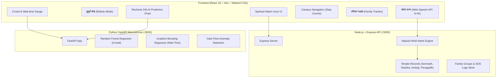

# 🕉️ YATRAMITRA AI (यात्रामित्र AI)
### आपकी यात्रा, आपकी भाषा, आपकी सुरक्षा।

> **A voice-first, multilingual, and accessibility-focused pilgrimage companion and crowd-management platform designed for elderly people, families, and ordinary devotees visiting sacred temples.**

[](https://opensource.org/licenses/MIT)
[](https://nodejs.org/)
[](https://python.org/)
[](https://reactjs.org/)
[](https://tailwindcss.com/)

---

## 🌟 The Core Vision

Unlike traditional temple management applications that require confusing form submissions, reading tiny font sizes, or navigating complex menus, **YatraMitra AI** is designed from the ground up for **elderly pilgrims (बुजुर्ग)**, rural families, and everyday devotees who may have difficulty reading small text or typing on mobile screens.

Through **natural Hindi voice guidance**, **high-contrast large touch targets**, **real-time crowd telemetry**, **family reconnection**, and **smart AI queue forecasting**, YatraMitra transforms an overwhelming crowded temple visit into a peaceful, dignified, and safe spiritual journey.

---

## 🏛️ Supported Sacred Temples (चार प्रमुख तीर्थ)

1. **श्री सोमनाथ ज्योतिर्लिंग मंदिर (Shree Somnath Jyotirlinga)** - प्रभास पाटन, वेरावल, गुजरात (प्रथम ज्योतिर्लिंग)
2. **श्री द्वारकाधीश मंदिर (Shree Dwarkadhish Temple / Jagat Mandir)** - देवभूमि द्वारका, गुजरात
3. **श्री आरासुरी अम्बाजी माता मंदिर (Shree Ambaji Mata Temple)** - बनासकांठा, गुजरात (प्रमुख शक्तिपीठ)
4. **श्री महाकाली माताजी मंदिर (Shree Mahakali Temple, Pavagadh)** - पावागढ़ पहाड़ी, गुजरात (नव-निर्मित शिखर व रोपवे)

---

## ⚡ Core Feature Highlights

### 1. 🎙️ "बोलो यात्रा" – Hindi Voice Assistant (Hands-Free Voice Guidance)
- **Web Speech API (`hi-IN`) Speech Recognition**: Devotees tap a pulsating microphone and speak naturally in Hindi.
- **Natural Intent Recognition & Verified Facts**: Directly maps queries like:
  - *"मंदिर में कितनी भीड़ है?"* (How big is the crowd?)
  - *"दर्शन में कितना समय लगेगा?"* (How long will Darshan take?)
  - *"शौचालय कहाँ है?"* (Where is the nearest restroom?)
  - *"पीने का पानी कहाँ मिलेगा?"* (Where is cold drinking water?)
  - *"जूता स्टैंड कहाँ है?"* (Where is the footwear counter?)
  - *"मेडिकल सहायता कहाँ मिलेगी?"* (Where is the doctor / first-aid?)
  - *"पार्किंग कहाँ है?"* (Where is parking and e-rickshaw shuttle?)
  - *"व्हीलचेयर कहाँ मिलेगी?"* (Where are wheelchairs for seniors?)
- **SpeechSynthesis (`hi-IN`) Output**: Speaks back in a warm, gentle, authentic Hindi voice with repeat (`पुनः सुनें`) and stop controls.
- **Fallback Text & Quick Suggestion Chips**: Easily type or click prompt chips when mic permission is disabled.

---

### 2. 🧓 "बुजुर्ग साथी" – Dedicated Elderly Mode (बुजुर्ग मोड)
- **Massive High-Contrast Typography & 64px+ Touch Targets**: Designed for aging eyes and shaky hands.
- **Essential Simplified Action Cards**: Eliminates non-essential UI clutter:
  1. *दर्शन का समय व भीड़* (Wait time & crowd status)
  2. *कहाँ क्या है?* (Water 45m, Toilet 70m, Shoes 30m with step count)
  3. *बोलो यात्रा* (Voice query without typing)
  4. *मेरा परिवार कहाँ है?* (Safe reunion point)
  5. *🚨 आपातकालीन मदद (SOS)* (Massive glowing red emergency button)
- **Automatic Read-Aloud**: Tapping cards reads directions and advice aloud in Hindi.

---

### 3. ⏱️ Live Crowd Telemetry & Darshan Waiting Time Gauge
- Live occupancy percentage and current devotee counter.
- **Gate-by-Gate Comparison**: Highlighting general queue wait time vs. **वरिष्ठ नागरिक सुगम कतार (Gate 2 Senior Priority Gate)**.
- **Aarti Schedule**: Real-time status of Daily Aartis (प्रातः आरती, मध्याह्न आरती, संध्या महाआरती) with audio playback.
- Ropeway live operational status for Pavagadh hill.

---

### 4. 📍 Campus Navigation & Facilities Finder (कहाँ क्या है?)
- Distance in meters and step counts (e.g., 70m / ~95 कदम).
- Direction guidance (e.g., *दिग्विजय द्वार से पूर्व दिशा में, रैंप युक्त*).
- Filter by **बुजुर्ग / रैंप अनुकूल** (Elderly & Wheelchair Accessible).
- One-tap audio directions button (`दिशा निर्देश सुनें`).

---

### 5. 👨‍👩‍👧‍👦 "परिवार रक्षक" – Family Companion & Lost Member Alert
- **4-Digit Group Code (e.g., `YATRA-108`)**: Easily connect family members across phones.
- **Live Status Feed**: See whether a family member is in queue, at shoe counter, drinking water, or at meet point.
- **1-Tap Check-In ("मैं यहाँ हूँ")**: Share updated location in 1 click.
- **तय मिलन स्थल (Designated Reunion Points)**: Fixed landmark where family reunites if lost.
- **खोया सदस्य रिपोर्ट**: Immediately sends a priority alert to Temple Control Room and broadcasts loudspeaker announcements!

---

### 6. 🚨 Emergency SOS & Medical Rapid Response
- One-tap SOS trigger logging the incident with coordinates.
- **Audible Siren Alarm**: Web Audio API siren to attract immediate attention in dense crowds.
- Direct quick-dial to **108 Ambulance**, **Temple Police Post**, and **Trust Helpline**.
- Calming spoken reassurance to avoid crowd panic.

---

### 7. 📊 Temple Control Room & AI Prediction Dashboard (For Authorities)
- Built for temple trusts, district collectors, police, and disaster management teams.
- **Machine Learning 24-Hour Crowd & Queue Forecast (Recharts)**: Hourly curves capturing Aarti surges and recommending optimal low-crowd darshan windows (*सुगम दर्शन समय*).
- **Inflow / Egress Velocity & Gate Flow Rates**.
- **Public Address (PA) Broadcaster**: Dispatches live audio announcements directly to pilgrims' apps.

---

## 🛠️ Technology Architecture



---

## 🚀 Quick Start Guide

### Prerequisites
- **Node.js**: v18+ (Tested on v22.19)
- **Python**: v3.10+ (Tested on v3.12)
- Modern web browser (Chrome, Edge, Safari, or Firefox with Web Speech API support)

---

### Installation

1. **Clone repository:**
   ```bash
   git clone https://github.com/Sarika17-ui/BUILD-YATRAMITRA-AI.git
   cd BUILD-YATRAMITRA-AI
   ```

2. **Install Frontend Dependencies:**
   ```bash
   cd client
   npm install
   ```

3. **Install Backend Dependencies:**
   ```bash
   cd ../server
   npm install
   ```

4. **Install AI Service Dependencies (Python):**
   ```bash
   pip install fastapi uvicorn scikit-learn pandas numpy
   ```

---

### Running the Platform

#### Option A: One-Click Windows Launcher
Double-click `run_all.bat` in the root folder. It starts all three microservices in separate windows.

#### Option B: Manual Command Line Launch

**Terminal 1 - Python AI Prediction Engine:**
```bash
cd ai_service
python main.py
# Runs on http://localhost:8000
```

**Terminal 2 - Express API Server:**
```bash
cd server
npm start
# Runs on http://localhost:5000
```

**Terminal 3 - React Frontend (Vite):**
```bash
cd client
npm run dev
# Open http://localhost:5173
```

---

## 🎨 Cultural & Accessibility Design Philosophy

- **Backgrounds**: Warm Ivory (`#FAF7F2`, `#FAF6EE`) - reduces glare compared to harsh pure white.
- **Primary Teal**: Deep Sacred Teal (`#0F4C5C`) - evokes stability, serenity, and governmental trust.
- **Saffron & Marigold**: (`#E36414`, `#FB8500`) - auspicious cultural warmth for buttons and highlights.
- **Typography**: Nirmala UI / Hind / Cinzel / Rozha One with fallback Devanagari typography.
- **Elderly Focus**: Minimal typing required, high touch clearance, soothing auditory feedback, and prominent SOS assistance.

---

## 📜 License
Developed with devotion for pilgrims and temple trusts. MIT License.
**YatraMitra AI — आपकी यात्रा, आपकी भाषा, आपकी सुरक्षा।**
